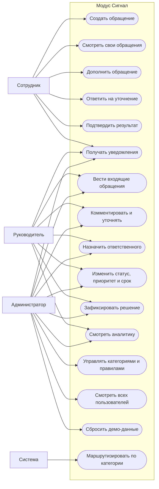
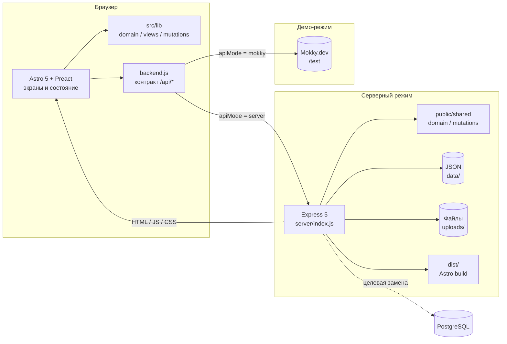
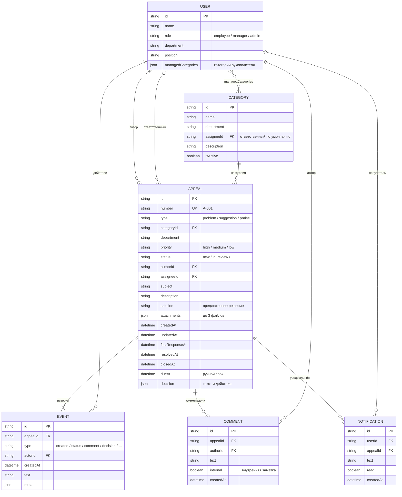
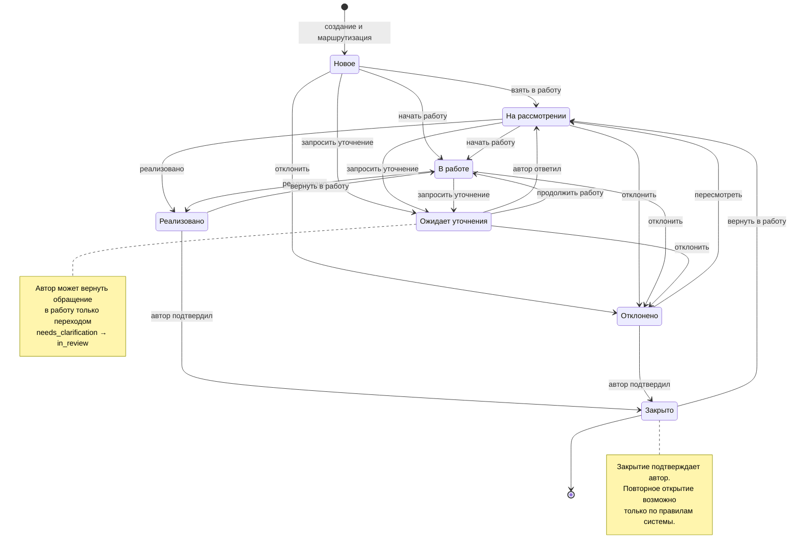
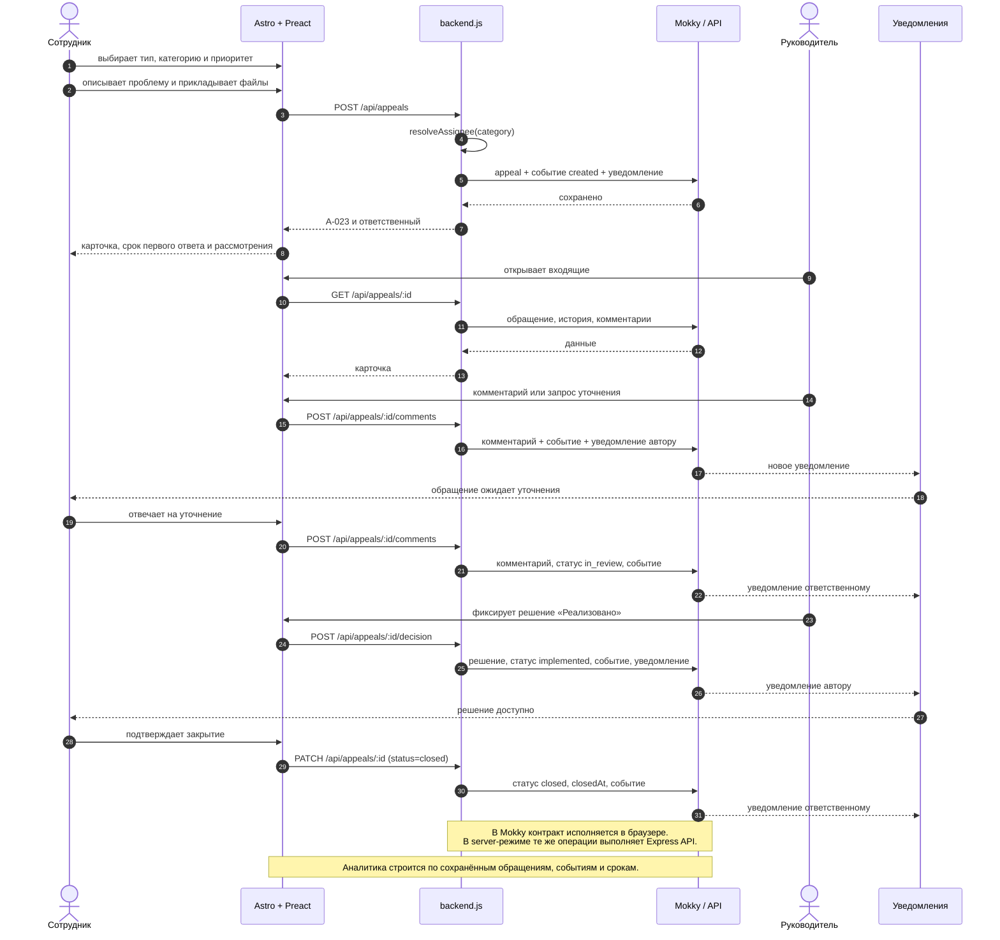

# UML-модель «Модус Сигнал»

Диаграммы описывают текущий MVP на Astro 5 + Preact и синхронизированы с кодом:

- роли, статусы, переходы и маршрутизация — `src/lib/domain.js`;
- создание, комментарии, решения и уведомления — `src/lib/mutations.js`;
- состав сущностей и демо-данные — `server/seed.js`;
- контракт хранения — `src/lib/backend.js`, `server/index.js`.

Формат — **Mermaid**. Он рендерится в GitHub/GitLab, VS Code и большинстве Markdown-редакторов. Для вставки в презентацию можно открыть нужный блок в [Mermaid Live Editor](https://mermaid.live/) и экспортировать PNG/SVG.

---

## 1. Диаграмма вариантов использования

**Что показывает:** три роли и автоматическая маршрутизация. Сотрудник работает со своими обращениями, руководитель — с входящими и результатом, администратор — со справочником и демо-стендом. Внутренние заметки и аналитика ограничены матрицей доступа.

---

## 2. Компонентная диаграмма

**Что показывает:** один клиент и один контракт `/api/*`; адаптер переключает Mokky.dev и собственный Express API. В серверном режиме Express также раздаёт собранный Astro-фронтенд из `dist/`. PostgreSQL показан как целевое хранилище, а не как текущая реализация.

---

## 3. ER-модель данных

`attachments` — **встроенный массив** в обращении, а не отдельная коллекция. В нём хранятся имя, размер, MIME-тип и URL/Data URL файла. `decision` также встроен в обращение и дополняется событием в истории.

---

## 4. Состояния обращения

**Полномочия на переходы:**

| Роль | Что может |
|---|---|
| Руководитель / ответственный / администратор | все переходы, разрешённые из текущего статуса |
| Автор | `needs_clarification → in_review`, `implemented → closed`, `rejected → closed`, `closed → in_review` |
| Другие сотрудники | не могут изменять обращение |

SLA не является статусом: срок первого ответа и срок рассмотрения рассчитываются по приоритету и отображаются флагом просрочки. Ручной `dueAt` заменяет расчётный срок рассмотрения.

---

## 5. Последовательность основного сценария

**Что показывает:** сквозной путь из ТЗ — создание, автоматическая маршрутизация, уточнение, решение и подтверждение автором. Номер `A-023` использован как пример следующего обращения после демо-набора из 22 записей.

---

## Соответствие слайдам защиты

| Диаграмма | Куда показывать |
|---|---|
| Use case | «Пользователи и сценарии» |
| Компоненты | «Что под капотом» |
| ER | «Данные и хранение» |
| Состояния | «Процесс рассмотрения и SLA» |
| Sequence | «Основной сценарий» или ответ на вопрос «как это работает?» |

При изменении статусов, ролей или состава сущностей обновляйте этот файл вместе с `src/lib/domain.js` и `server/seed.js`, чтобы диаграммы не расходились с MVP.
